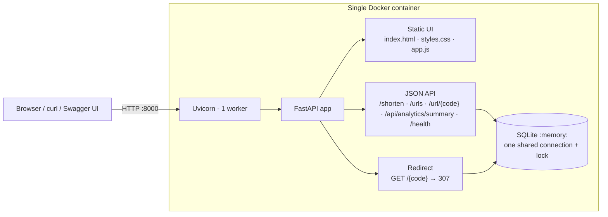

# LinkLab — URL Shortener Service

> **Problem statement:** a minimal service to redirect long URLs to short aliases.
> **Architecture:** a lightweight API using an **in-memory SQLite** database inside a **single container**.

LinkLab is a FastAPI application. You submit a long URL and it returns a short alias such as `http://localhost:8000/spring-sale`. When someone opens that alias, the service looks the code up in SQLite and responds with a real HTTP **307 redirect** to the original destination, counting the click.

The same process serves three things from one container on one port:

- the web interface (HTML, CSS and JavaScript)
- the JSON API
- the redirects

Swagger documentation is available at `/docs`.

---

## Features

| Area | What is implemented |
|---|---|
| Shortening | `POST /shorten` with strict URL validation. Random 7-character codes come from a cryptographically secure RNG (`secrets`). Optional custom alias. Optional expiry. |
| Redirects | `GET /{code}` → `307 Temporary Redirect` with `Cache-Control: no-store`. A click is counted only when the redirect is actually issued. |
| Expiry | Expiry timestamp stored in SQLite. Expired links return **410 Gone**, as an HTML page for browsers and JSON for API clients. They never redirect. |
| Management | List links (`GET /urls`), view details (`GET /url/{code}`), delete (`DELETE /url/{code}`) with a confirmation dialog in the UI. |
| Dashboard | Stored, active and expired links, total clicks, links created in the last 24 h, most-clicked link. Every number is computed by SQL over the real data. |
| QR codes | `GET /url/{code}/qr` returns an SVG QR code that encodes the short URL. It is generated by `segno`, a pure-Python library with no system packages. |
| Web UI | Responsive (desktop, tablet, mobile), light and dark themes, keyboard accessible. Copy to clipboard, search, sort, empty, loading and error states, toasts. No external fonts, CDNs or analytics. |
| Safety | Parameterised SQL everywhere. Reserved route names are protected. Per-IP rate limit on link creation. Security headers including a strict CSP. All user text is rendered with `textContent`, never as HTML. |
| Ops | `/health` runs a real query against the database. A Docker `HEALTHCHECK` uses it. The container runs as a non-root user. |
| Quality | 101 automated tests (pytest) plus a GitHub Actions workflow that runs them and smoke-tests the Docker image. |

---

## Architecture



```text
Browser ──HTTP──▶ ┌──────────────── one container (port 8000) ────────────────┐
                  │ Uvicorn (1 worker) → FastAPI                               │
                  │   ├── /, /static/*        web UI (HTML/CSS/JS)             │
                  │   ├── /shorten, /urls ... JSON API                         │
                  │   └── /{code}             307 redirect + click count       │
                  │                 │                                           │
                  │                 ▼                                           │
                  │     sqlite3.connect(":memory:")  ← lives in RAM only        │
                  └────────────────────────────────────────────────────────────┘
```

**Why there is exactly one connection and one worker.** A SQLite `:memory:` database exists only inside the connection that created it. A second connection, or a second Uvicorn worker process, would see a different, empty database.

LinkLab therefore opens **one** connection at startup (in the FastAPI *lifespan* handler) and closes it at shutdown. Every request uses that connection.

FastAPI runs normal `def` endpoints in a thread pool, and a SQLite connection must not be used by several threads at once. So every database access goes through `Database.session()` (in [`app/database.py`](app/database.py)), which does two things:

1. takes a `threading.Lock`, so one operation runs at a time;
2. wraps the work in a transaction that is committed on success and rolled back on error.

Because of this, "check that the link has not expired, then add one to its click count" is atomic. Concurrent visits never lose or double-count clicks, and the tests check this with 200 parallel redirects.

**Uniqueness is enforced by the database.** `short_code` is the `PRIMARY KEY`. Creation simply tries the `INSERT`. If SQLite reports a uniqueness clash:

- for a **custom alias**, the API returns **409**;
- for a **random code**, it tries a new code, up to 10 times, and then returns a controlled **503** rather than looping forever.

There is no "check first, insert later" race.

### Database schema

```sql
CREATE TABLE urls (
    short_code   TEXT    PRIMARY KEY CHECK (length(short_code) BETWEEN 3 AND 30),
    original_url TEXT    NOT NULL    CHECK (length(original_url) BETWEEN 1 AND 2048),
    created_at   TEXT    NOT NULL,              -- ISO-8601 UTC
    clicks       INTEGER NOT NULL DEFAULT 0 CHECK (clicks >= 0),
    expires_at   TEXT,                          -- NULL = never expires
    CHECK (expires_at IS NULL OR expires_at > created_at)
);
```

---

## ⚠️ In-memory storage: what it means

- The database is created in RAM when the app starts and **destroyed when the process stops**. All links and click counts are lost when:
  - the container restarts or is redeployed;
  - the host scales the container to zero;
  - the app crashes.
- There is **no persistence and no backup**, by design. The specification asks for an in-memory database, and the code deliberately has no setting to switch to a database file.
- Running **more than one worker or replica** would give each process its own separate set of links. Keep it to exactly one. The Dockerfile pins `--workers 1`.
- Memory grows with the number of links. A small instance comfortably holds hundreds of thousands of rows, but nothing is evicted automatically.

`GET /health` reports `"storage": "sqlite-in-memory"`. This value is detected from SQLite itself (`PRAGMA database_list`), not hard-coded.

---

## Tech stack

- **Python 3.12**, **FastAPI**, **Pydantic v2**, **Uvicorn**
- **SQLite** through Python's built-in `sqlite3` module (no ORM)
- **segno** for QR codes (pure Python)
- Vanilla **HTML, CSS and JavaScript** with no build step and no framework
- **pytest** with FastAPI's `TestClient`
- **Docker** and Docker Compose, plus GitHub Actions CI

## Project structure

```text
url-shortener-service/
├── app/
│   ├── __init__.py
│   ├── main.py          # FastAPI app factory: routes, error handlers, security headers
│   ├── database.py      # in-memory SQLite connection, schema, lock + transactions
│   ├── models.py        # Pydantic schemas, URL/alias validation, reserved names
│   ├── services.py      # business logic (all SQL lives here, parameterised)
│   ├── ratelimit.py     # small in-memory sliding-window rate limiter
│   └── static/
│       ├── index.html   # LinkLab web UI
│       ├── styles.css
│       ├── app.js
│       └── favicon.svg
├── tests/
│   ├── conftest.py      # fresh app + fresh in-memory DB per test, fake clock
│   ├── test_api.py
│   └── test_ratelimit.py
├── .github/workflows/tests.yml
├── Dockerfile
├── compose.yaml
├── requirements.txt     # runtime dependencies (in the image)
├── requirements-dev.txt # + pytest, httpx2 (tests only)
├── pytest.ini
├── .dockerignore
└── .gitignore
```

---

## Running it

### Option A: Docker (recommended)

```bash
docker build -t linklab .
docker run --rm -p 8000:8000 linklab
```

or, with Compose (it builds and runs the same single container):

```bash
docker compose up --build
# stop:   Ctrl+C, then  docker compose down
```

Then open:

- Web app: <http://localhost:8000>
- Swagger UI: <http://localhost:8000/docs>
- ReDoc: <http://localhost:8000/redoc>
- Health: <http://localhost:8000/health>

> If you get `port is already allocated`, something else is using port 8000. This can be an older container from this project. Run `docker ps` to find it, then `docker stop <name>`, or map another port: `docker run --rm -p 8080:8000 linklab`.

### Option B: local Python

```bash
python -m venv .venv
# Windows
.venv\Scripts\activate
# macOS / Linux
source .venv/bin/activate

pip install -r requirements-dev.txt
uvicorn app.main:app --reload
```

### Configuration (environment variables)

| Variable | Default | Purpose |
|---|---|---|
| `PORT` | `8000` | Port Uvicorn listens on inside the container. Many hosting platforms set this automatically. |
| `RATE_LIMIT_PER_MINUTE` | `30` | Link creations allowed per client IP per minute. `0` disables the limit. |
| `PUBLIC_BASE_URL` | *(empty)* | Overrides the origin used to build `short_url`, e.g. `https://linklab.example.com`. Useful behind a TLS-terminating proxy. |
| `FORWARDED_ALLOW_IPS` | `127.0.0.1` | Read by Uvicorn. IPs whose `X-Forwarded-*` headers are trusted. Set it to your proxy's address when deployed behind one. |

There is intentionally **no** variable for the database location.

---

## API

All responses are JSON unless stated otherwise. Errors always have the shape `{"detail": "human readable message"}`. Validation errors (422) also include `"errors": [{"field": ..., "message": ...}]`.

| Method | Path | Purpose | Success | Errors |
|---|---|---|---|---|
| `POST` | `/shorten` | Create a short link | **201** | 400 (points at this service), 409 (alias taken), 422 (invalid input), 429 (rate limit), 503 (database unavailable or no free code) |
| `GET` | `/{code}` | Redirect to the destination and count a click | **307** | 404 (unknown), 410 (expired) |
| `GET` | `/url/{code}` | Link details | 200 | 404 |
| `DELETE` | `/url/{code}` | Delete a link | **204** | 404 |
| `GET` | `/url/{code}/qr` | QR code (SVG) of the short URL | 200 `image/svg+xml` | 404 |
| `GET` | `/urls?limit=500` | Stored links, newest first (`limit` 1–1000) | 200 | 422 |
| `GET` | `/api/analytics/summary` | Dashboard totals | 200 | |
| `GET` | `/health` | Liveness and database readiness (runs a real query) | 200 | 503 |

The `/{code}` redirect route is registered **last**, so `/health`, `/docs`, `/redoc`, `/openapi.json`, `/urls`, `/static/...` and `/` can never be taken over by a short code.

### Validation rules

- **URL**
  - must be `http://` or `https://`;
  - must have a valid hostname: a dotted domain name (internationalised names allowed), an IPv4/IPv6 address, or `localhost`;
  - at most 2048 characters;
  - no spaces or control characters, and no `user:password@` credentials;
  - may not point at this service itself (to prevent redirect loops).

  `javascript:`, `data:`, `file:`, `ftp:` and `mailto:` are rejected. The URL is stored exactly as submitted, with only surrounding whitespace trimmed, so paths and query strings are never rewritten. The server never fetches the destination.
- **Custom alias**
  - 3–30 characters from `A–Z a–z 0–9 - _`;
  - **case-sensitive**: `Promo` and `promo` are different links;
  - reserved names such as `docs`, `health`, `api`, `static`, `url`, `urls` and `shorten` are rejected, case-insensitively.
- **Expiry**: `expires_in_minutes` is an integer from 1 to 525600 (one year). Omit it for a link that never expires. A link is expired from the exact `expires_at` instant onward.

### Example requests

Examples use `curl` in a POSIX shell (macOS/Linux/Git Bash). In Windows PowerShell, use `curl.exe` and escape the inner quotes, or use Swagger UI.

**Create a random short link**

```bash
curl -i -X POST http://localhost:8000/shorten \
  -H "Content-Type: application/json" \
  -d '{"url": "https://example.com/a/very/long/page?utm_source=newsletter"}'
```

```http
HTTP/1.1 201 Created
content-type: application/json

{
  "short_code": "Qm3xT8a",
  "short_url": "http://localhost:8000/Qm3xT8a",
  "original_url": "https://example.com/a/very/long/page?utm_source=newsletter",
  "created_at": "2026-10-16T10:03:10Z",
  "clicks": 0,
  "expires_at": null,
  "is_expired": false
}
```

**Custom alias that expires after 24 hours**

```bash
curl -X POST http://localhost:8000/shorten \
  -H "Content-Type: application/json" \
  -d '{"url": "https://example.com/sale", "custom_alias": "spring-sale", "expires_in_minutes": 1440}'
```

**Alias already in use → 409**

```json
{"detail": "The alias 'spring-sale' is already taken."}
```

**Invalid URL → 422**

```bash
curl -X POST http://localhost:8000/shorten -H "Content-Type: application/json" -d '{"url": "javascript:alert(1)"}'
```

```json
{"detail": "Only http:// and https:// URLs can be shortened.",
 "errors": [{"field": "url", "message": "Only http:// and https:// URLs can be shortened."}]}
```

**Follow the redirect**

```bash
curl -i http://localhost:8000/spring-sale
```

```http
HTTP/1.1 307 Temporary Redirect
location: https://example.com/sale
cache-control: no-store
```

**Details, list, summary, QR, delete**

```bash
curl http://localhost:8000/url/spring-sale
curl http://localhost:8000/urls
curl http://localhost:8000/api/analytics/summary
curl -o spring-sale.svg http://localhost:8000/url/spring-sale/qr
curl -i -X DELETE http://localhost:8000/url/spring-sale     # 204 No Content
curl http://localhost:8000/health
```

```json
{"status": "ok", "database": "ok", "storage": "sqlite-in-memory", "links": 1}
```

**Meaning of the dashboard numbers** (`/api/analytics/summary`):

- `total_links`: every mapping currently stored in SQLite, active or expired.
- `active_links`: links that will still redirect.
- `expired_links`: links past their expiry. They are still listed but no longer redirect.
- `total_clicks`: the sum of recorded redirects over the stored links. Clicks of deleted links are gone with them.
- `links_created_24h`: links created during the last 24 hours.
- `top_link`: the most-clicked link, or `null` if nothing has been clicked yet.

---

## Tests

```bash
pip install -r requirements-dev.txt
pytest
```

Each test builds a **new app instance with its own fresh in-memory database**, so no state leaks between tests. A fake clock makes expiry tests instant, and no test touches the network. The suite covers:

- health, including 503 when the database is closed;
- creation, custom aliases and duplicate-alias 409s;
- reserved and invalid aliases;
- random-code uniqueness, collision retry and the bounded retry failure;
- valid and invalid URLs (dangerous schemes, missing scheme, bad hosts, credentials, overlong input), and that URLs are stored verbatim;
- 307 redirects and click counting, including that reads don't count as clicks;
- 404s (JSON and HTML, with escaping), details, listing order and limits;
- analytics totals, deletion and alias reuse, and expiry (410, never redirects);
- QR content;
- database startup and shutdown, data loss on restart, isolation between instances, no database file written, schema constraints;
- **concurrency**: 200 parallel redirects, 100 parallel creations, and 40 racing requests for one alias where exactly one wins;
- reserved routes, static files, security headers, the rate limit, and SQL injection strings.

GitHub Actions ([`.github/workflows/tests.yml`](.github/workflows/tests.yml)) runs the suite on every push and pull request. It then builds the Docker image and smoke-tests the running container: health, create, redirect and UI.

---

## Deployment

The authoritative deliverable is the Docker image: one container, one process, in-memory SQLite. Deploy it to any host that runs a Dockerfile as a long-lived web service, for example **Render** (Web Service → Docker), **Railway**, **Fly.io**, **Koyeb** or **Google Cloud Run**.

Example with Render:

1. Push this repository to GitHub.
2. In Render: **New → Web Service**, then select the repository. Render detects the `Dockerfile`.
3. **Instance count: 1.** Do not enable autoscaling, because each instance would have its own separate database.
4. **Health check path:** `/health`.
5. **Port:** Render sets `PORT` automatically and the container listens on it. On platforms that don't set `PORT`, expose port **8000**.
6. Optional: set `PUBLIC_BASE_URL=https://<your-service>.onrender.com`. Also set `FORWARDED_ALLOW_IPS="*"` so that short URLs use `https` and the rate limiter sees real client IPs. Only do this on platforms where all traffic arrives through the platform's proxy.

For Cloud Run, set **max instances = 1** and preferably **min instances = 1**.

**Limitations to state honestly.** Every redeploy, restart, crash or idle shutdown wipes every link. Free tiers that sleep when idle (Render free, for example) therefore lose all data after a period of inactivity. That is the expected behaviour of the required in-memory design, not a bug. Persistent storage would need a SQLite file on a volume or a database server, which is a deliberate change of architecture that this project does not make.

### Why not Vercel?

Vercel runs Python as **serverless functions**, not as a long-lived Docker container. Each invocation may run in a different, short-lived instance, so a process-local `:memory:` database would not be shared between requests. A link created in one request could be missing in the next.

Making it work there would require swapping in a hosted database, which breaks the specified architecture. This repository therefore ships **no** Vercel configuration and makes no claim of Vercel support.

---

## Security notes and known limitations

URL shorteners are attractive to abusers because a short link hides where it really goes. LinkLab includes sensible baseline protections:

- strict validation, with no `javascript:`, `data:` or `file:` URLs and no embedded credentials;
- parameterised SQL;
- reserved routes;
- a per-IP creation rate limit;
- `nosniff`, `X-Frame-Options: DENY`, `Referrer-Policy: no-referrer` and a strict Content-Security-Policy on its own pages;
- no HTML rendering of user input;
- no requests to submitted URLs;
- no cookies, accounts or personal data beyond the connecting IP, which the rate limiter keeps briefly in memory.

It is **not production-hardened**:

- **No accounts or ownership.** Anyone who can reach the service can list, view **and delete** any link. That is fine for a classroom demo or a trusted network, but not for the public internet.
- **No malicious-URL screening.** There is no Safe Browsing or blocklist check, so phishing or malware links could be shortened. A public deployment would need that, plus abuse reporting and monitoring.
- **The rate limit is in memory.** It resets on restart, is per process, and is keyed by IP. Users behind the same NAT share a budget, and behind a proxy you must configure `FORWARDED_ALLOW_IPS` or every visitor looks like the proxy. Only `POST /shorten` is limited.
- **Swagger UI and ReDoc** (`/docs`, `/redoc`) load their assets from a CDN. They are therefore exempt from the strict CSP and need internet access in the browser. The LinkLab UI itself uses no external resources.
- **The listing is capped.** `GET /urls` returns at most 1000 links, newest first, and the UI searches within those.
- **The data is ephemeral**, as explained in the in-memory storage section above.
